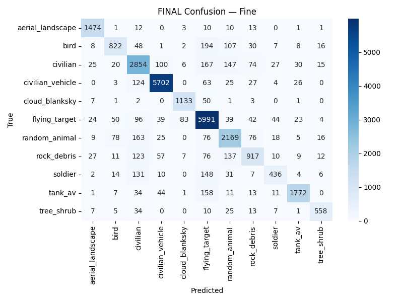
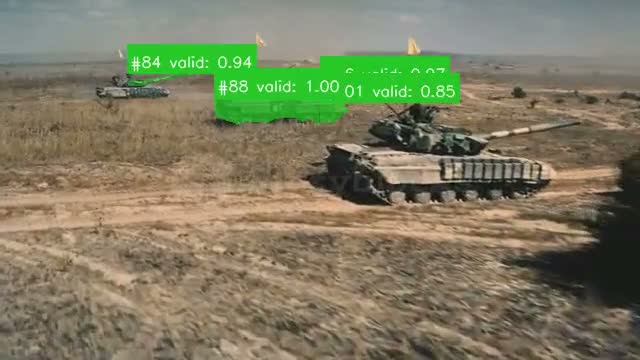

# Drone Target Identification Model

An end-to-end deep-learning pipeline for drone- and camera-based target identification. It unifies
heterogeneous public image datasets, trains a multi-output CNN that predicts both a fine-grained
object class and a coarse valid/invalid label, and embeds the trained classifier behind a YOLO
segmentation front-end for real-time video.

Project page: **[loganmedwardsastrophy.com/drone-target.html](https://www.loganmedwardsastrophy.com/drone-target.html)**

## Results

Held-out test set: **27,362 samples** across 11 fine classes. Naïve single-class baselines reach
23.52% (fine) and 34.50% (coarse), so both heads have to learn real structure to be useful.

| Head | Accuracy | Macro F1 | Baseline |
|---|---|---|---|
| Fine (11-way) | **87.08%** | 0.8358 (P 0.8570 / R 0.8208) | 23.52% |
| Coarse (3-way valid/invalid) | **91.31%** | 0.9129 (P 0.9128 / R 0.9130) | 34.50% |

<p align="center">
  
</p>

Per-class precision is strongest on visually distinct categories (`civilian_vehicle` 0.954,
`tank_av` 0.943, `aerial_landscape` 0.931) and weakest where classes share appearance
(`rock_debris` 0.755, `soldier` 0.773, `civilian` 0.788). Recall is weakest on `soldier`: the fine
head finds 436 of 789 (55.3%). Of the misses, 148 go to `flying_target`, still a valid class, and 131
to `civilian`, a non-target. Full breakdowns,
including per-class recall and both confusion matrices, are in
[`results/test_detailed_metrics.txt`](results/test_detailed_metrics.txt).

In both runs' `training_curves.png`, the dashed lines in the loss panel are validation loss, but the
legend labels them the same as the training lines (a plotting bug since fixed in `train_model.py`).

### Which run these numbers come from

The architecture was trained at several input resolutions. The figures above — and the ones on the
project page — are the **256 × 256 / 20-epoch** run, and `results/` at the top level holds that run's
artifacts.

[`results/resolution-study-128x128/`](results/resolution-study-128x128) holds the **128 × 128 /
50-epoch** run for comparison: 87.62% fine / 91.17% coarse on the same 27,362-sample test set. The
two land within a few tenths of a point of each other, which is what "differences negligible" in the
original folder names refers to. 64 × 64 was clearly worse and 256 × 256 added very little over
128 × 128, so for offline classification 128 × 128 is the sweet spot on cost.

## Pipeline

Three modular stages, each independently runnable.

| Stage | Script | Notebook | What it does |
|---|---|---|---|
| 1. Dataset builder | [`src/build_dataset.py`](src/build_dataset.py) | [`01_cataloguing_pipeline`](notebooks/01_cataloguing_pipeline.ipynb) | Pulls images from KaggleHub sources, reorganizes them into a single `images/` tree and a unified `metadata.csv`, hash-dedupes, and aliases dataset-specific terms onto canonical labels. |
| 2. Training | [`src/train_model.py`](src/train_model.py) | [`02_training_testing_network`](notebooks/02_training_testing_network.ipynb) | Trains the multi-output CNN (fine + coarse heads), writes confusion matrices, classification reports and training curves. |
| 2b. Evaluation | [`src/evaluate_model.py`](src/evaluate_model.py) | (same notebook, 2nd cell) | Detailed test metrics for a trained checkpoint: per-class accuracy, micro/macro/weighted P/R/F1, confusion matrices. |
| 3. Real-time | [`src/realtime_yolo_classifier.py`](src/realtime_yolo_classifier.py) | [`03_video_implementation`](notebooks/03_video_implementation.ipynb) | YOLO segmentation produces per-frame instance masks; each mask is cropped, normalized to match training, classified, and overlaid on the source frame in the predicted coarse label's colour. |

### Labels

11 fine classes map onto 3 coarse validity buckets (see [`models/label_map.json`](models/label_map.json)):

- **valid** — `soldier`, `tank_av`, `flying_target`
- **invalid_nontarget** — `civilian`, `civilian_vehicle`
- **invalid_background** — `aerial_landscape`, `cloud_blanksky`, `tree_shrub`, `rock_debris`, `random_animal`, `bird`

The live overlay consults only the coarse head: the operational question is "valid target?". `valid`
renders green, `invalid_nontarget` red, and `invalid_background` is suppressed entirely.

`label_map.json` lists the coarse classes alphabetically. That is not the coarse head's output order,
which `train_model.py` fixes as `invalid_nontarget`, `invalid_background`, `valid`; the real-time
script reads the head in that trained order.

<p align="center">
  
</p>

## Model

A compact multi-output ConvNet, as defined in `src/train_model.py`: three
`Conv2D(3×3, ReLU) → MaxPool(2×2)` blocks with growing channel depth (32 → 64 → 128), then
`Flatten → Dense(256, ReLU) → Dropout(0.5)` feeding two softmax heads (11-way fine, 3-way coarse).
Both heads train jointly with sparse categorical cross-entropy, weighted equally. Every kernel carries
L2 regularization (1e-5), and AdamW (lr 1e-3, weight decay 1e-6) runs under a plateau schedule that
halves the learning rate after 5 flat epochs. The checkpoint with the lowest validation loss is kept.

All sample weights are 1. Setting `IGNORE_INVALID_IN_FINE = True` zeroes the fine-head weight of
non-`valid` examples, so they train only the coarse head.

All three runs use this network. The shipped 32 × 32 weights match it layer for layer (621,390
parameters), and the offline checkpoint sizes below are exactly what it predicts with AdamW state:
33.7 M parameters at 256 × 256 and 8.5 M at 128 × 128. The report in `docs/` describes a broader
design, with batch normalization, global average pooling, augmentation, class re-weighting, a
coarse-head warm-up and mixed precision. None of those are in the scripts or in the shipped weights.

**Input resolution.** Going from 64×64 to 128×128 improved both heads substantially; 256×256 added
very little. For the live video pipeline, *lower*-resolution crops actually helped — they kept the
YOLO + CNN loop closer to real time and improved detection of small, distant targets.

## Data

The unified training corpus is published on Kaggle:
**[loggger/fpv-images](https://www.kaggle.com/datasets/loggger/fpv-images)** (~272k labeled paths
collected, 182,413 samples used after balancing and de-duplication).

`src/build_dataset.py` downloads it via `kagglehub` and rebuilds the corpus locally. The 27,362-image
test set is 15.0% of 182,413, which matches the 70/15/15 split in the report (`--splits 0.7 0.15 0.15`;
the builder's default is 80/10/10). `train_model.py` reads only the `train` and `test` rows. It carves
its validation set out of `train` (`VAL_FRACTION = 0.10`), so the builder's `val` rows go unused.

## Trained weights

[`models/best_model_32x32.h5`](models/best_model_32x32.h5) (7.2 MB) is the 32×32 classifier used by
the real-time video pipeline — the low-resolution crops that kept the YOLO + CNN loop closest to real
time. [`models/label_map.json`](models/label_map.json) is the matching class map. No test metrics were
recorded for this model; the published numbers are the offline runs'.

The offline checkpoints are too large for the repository: the 256 × 256 run behind the headline
numbers is ~385 MB, and the 128 × 128 run is ~97 MB. Rebuild either with `src/train_model.py` (see
below), or ask for a copy.

## Running it

Use Python 3.10–3.13 (as of TensorFlow 2.21 there are no wheels for 3.14). The shipped weights were
saved with Keras 3.10, so loading them needs TensorFlow 2.16 or newer, the first release built on
Keras 3.

```bash
pip install -r requirements.txt
```

```bash
python src/build_dataset.py --out data_kagglehub_unified --images-per-class 1000 --size 128
```

```bash
DATA_ROOT=data_kagglehub_unified python src/train_model.py
```

```bash
python src/realtime_yolo_classifier.py --source 0 --model models/best_model_32x32.h5 --label-map models/label_map.json
```

`--source` accepts a webcam index as a string (`"0"`) or a path to a video file. `--yolo-weights`
defaults to `yolov8n-seg.pt`; any YOLO *segmentation* checkpoint works. Crops are resized to the
classifier's own input size unless `--clf-img-size H W` says otherwise. For a video file the script
also writes `output/original.mp4` and `output/overlay_coarse.mp4` in a second, no-skip pass after the
preview closes; `--no-autosave-output` turns that off.

The training and evaluation scripts read their dataset root from the `DATA_ROOT` environment
variable, defaulting to `./data_kagglehub_unified`, and write to `DATA_ROOT/output/`.

`train_model.py` is left at `IMAGE_SIZE = (64, 64)` and `EPOCHS = 50`, which match none of the
published runs. To rebuild one, set these at the top of the file, and `IMAGE_SIZE` in
`evaluate_model.py` to match:

| Run | `IMAGE_SIZE` | `EPOCHS` | Artifacts |
|---|---|---|---|
| Headline | `(256, 256)` | 20 | [`results/`](results) |
| Resolution study | `(128, 128)` | 50 | [`results/resolution-study-128x128/`](results/resolution-study-128x128) |
| Real-time | `(32, 32)` | not recorded | [`models/best_model_32x32.h5`](models/best_model_32x32.h5) |

## Limitations

- **Borderline crops.** Segmentation masks that mix target and background pixels; when background
  dominates the crop the classifier defaults to an invalid label even when part of a target is visible.
- **Small or occluded targets.** Distant or partially blocked objects give too few pixels for a
  confident fine-class prediction.
- **Visually similar classes.** `soldier` vs `civilian` and `bird` vs `random_animal` are visible
  confusions, but no single pair dominates. The largest, `civilian` ↔ `random_animal`, is 310 of the
  fine head's 3,534 errors, and `flying_target` is the most common wrong prediction (952). In the
  coarse head, `invalid_background` ↔ `valid` (883 of 2,377 errors) edges out
  `invalid_nontarget` ↔ `invalid_background` (844).

## Repository layout

```
src/         runnable stage scripts
notebooks/   the original Colab notebooks (outputs stripped)
results/     the published 256x256 run: confusion matrix, curves, reports, full metrics;
             plus a frame from the live overlay
  resolution-study-128x128/   the same artifacts for the 128x128 run
models/      real-time classifier weights + label map
docs/        full technical report (PDF)
```

### Provenance

`notebooks/` holds the Colab notebooks with execution outputs stripped. `01` and `02` are otherwise
the originals. `03_video_implementation` already carries the relative `--model`, `--label-map` and
`--source` defaults described below, with the original local paths kept only in comments; its
untouched version was not preserved.

`src/` is the same code lifted out of those cells. Four edits make it portable:

- `train_model.py`, `evaluate_model.py` — `DATA_ROOT` now reads the `DATA_ROOT` environment variable
  and defaults to `./data_kagglehub_unified`, instead of a hard-coded `C:\Users\Owner\...` path.
- `realtime_yolo_classifier.py` — the `--model`, `--label-map` and `--source` argparse defaults point
  at relative paths instead of hard-coded local ones. The originals are kept in comments.
- `build_dataset.py` — the entry point calls `main()` rather than `main(argv=[])`, so command-line
  arguments are honoured when the file is run as a script.
- `build_dataset.py` — the JPEG quality default is written as `100` instead of `512`. JPEG quality is
  defined over 1–100; libjpeg silently clamps anything higher, so the corpus was always encoded at
  100 and the output is byte-for-byte unchanged. The literal now states what actually happened.

Three more fix bugs; the notebooks keep the original behaviour:

- `realtime_yolo_classifier.py` — the coarse head is read in its trained order. `train_model.py` fixes
  that order as `invalid_nontarget`, `invalid_background`, `valid`, but the script took the order from
  `label_map.json`, which sorts the names. Background crops were drawn red as `invalid_nontarget` and
  real non-targets were hidden as background; `valid`, last in both orders, was unaffected. Run on the
  shipped 32 × 32 weights, the coarse head agrees with the class implied by the fine head on 665 of
  800 probe images (crops of the demo frame plus flat and gradient patches) in the trained order, and
  on 227 in the label-map order.
- `realtime_yolo_classifier.py` — `--clf-img-size` defaults to the classifier's own input size. The
  old default, 256 × 256, cannot run the shipped 32 × 32 model.
- `train_model.py` — the loss panel of `training_curves.png` labels the validation curves as
  validation (see [Results](#results)).

Every other line matches the notebooks.

## Report

[`docs/Drone_Targeting_Model_Pipeline_Report.pdf`](docs/Drone_Targeting_Model_Pipeline_Report.pdf) —
full methodology, dataset construction, and error analysis.

## License

MIT — see [LICENSE](LICENSE).
